# Revision 2026-11-10: walkthrough arrows and the worked-example panel

中文摘要：“跟着算一次”的四个流程改了两处。模型上的数据流从扁平的色带换成圆管：起点一个圆点，终点一个箭头，两端各有标签，图上的线代表什么写在模型左上角；去和回两条线之间留出明显的间隔，短的箭头按长度缩小箭头和圆点，镜头会靠近这一步画的东西。右侧面板去掉了重复的信息：标题、一段说明，紧接着是一张从第一步到最后一步保持同一形状的数值图，再往下才是这一步的新名词。矩阵乘法里每一轮的 4 对数正下方写着它们现在在哪，这一步在处理的那一轮会框出来；其余三个流程用一份逐步增加的记录串起整个例子。

## What was wrong with the right panel

A reader with no context went through all 32 steps of the old version and wrote down what slowed them down (summary below; the full notes were the input to this revision). Four things, in plain words:

1. **The same fact was said five to seven times, and what the reader needed was not there.** Headline, paragraph, the row of route chips, the diagram header, the diagram, its caption and the 3D label often all restated one number (“acc becomes 19” appeared seven times on one step). The useful “where it happens” note was folded away or cut off under the Next button.
2. **The running example vanished at the hard steps.** In matrix multiply steps 3 and 5 the eight pairs of numbers disappeared while CTAs and warps were introduced. In address translation the full address was never in the panel, the page base appeared from nowhere and the value read never came back.
3. **Terms without definitions, and several names for one thing.** HBM, CTA, TMA, LD/ST, GPC, TPC, ROP, PHY were never explained; “shared TLB” and “L2 TLB”, “CTA”, “thread block” and “tile”, “lane” and “thread” were used for the same things.
4. **Small faults that each cost a pause.** Tiny matrix digits, animation dots covering labels, a highlight on k = 4 while the text said round 1, a “循环演示” header nobody could decode.

## What changed in the panel

The previous session (stopped before finishing) did most of the rewrite; this session kept it, fixed what it got wrong and finished it.

- **One figure per walkthrough that keeps its shape** from step 1 to step 8; a step only fills more of it in. No looping animation inside the panel, so nothing covers a label.
  - Matrix multiply: A's row, B's column and C's cell, then the eight pairs as a table. Under each round's four columns there is now a “where” cell (still in HBM, HBM → shared memory, shared memory → registers, registers → Tensor Core, in the accumulator). The round the step works on is outlined and the other is dimmed. The accumulator line appears when the Tensor Core starts.
  - Address translation: the full virtual address and its six fields stay on screen with the fields this step uses lit, and a record gains one line per step from the VA to the page base, the physical address and finally `A[3,0] = 2` in the register.
  - One pixel: the 8 × 8 target with the triangle and pixel (3, 4), the three vertices and their weights, and the same kind of record.
  - Stacking: one cross-section of the package with this step's parts lit, and the record.
- **Order:** title → one paragraph → the figure → “New in this step” (definitions of the terms the step introduces) → replay / pause → folded details. In the unfinished version the definitions sat between the paragraph and the figure and pushed the figure's current line under the footer; a browser test now checks that the current line is visible without scrolling on every step at 1280 × 800.
- **Glossary and one name per thing:** each step lists at most three new terms; the whole list is under “Glossary”. A unit test rejects “L2 TLB”, “lane”, “GEMM” and `A[3][0]` in the prose.
- The how-to-read notes in the address and stacking figures show on step 1 only instead of on every step.
- The row of route chips is gone. Its job, saying what the lines mean, moved to a key on the model itself (top left of the 3D view), one entry per colour and dash style drawn on that step, plus a one-line note.
- Fixed a bad edit in the unfinished work that had renamed the address-translation walkthrough “37 写回 HBM”; a test now checks walkthrough titles.

## What changed about the arrows

- Flat stepped ribbons without arrowheads became **round tubes with a start dot and an arrowhead**, corners rounded, with a dark outline so they stand off the die. A brighter comet travels towards the head while the step plays, and the head shows direction in a still frame too. Dashed tubes mean a relation that moves nothing (a dependency, a work assignment).
- **Labels sit just outside the patch they name**, beside the route end, not on top of it. Walkthroughs start with labels on, since the arrows are named by them; Anatomy keeps them off by default.
- **Lanes that run together keep a gap.** Address translation steps 4–5 had the purple request and the teal reply 0.2 units apart, which read as one band; they now run as an inner and an outer lane (and the reply enters the GMMU from the other side). A unit test checks every step on both models: two differently coloured routes on one host may not run within three tube widths of each other for more than a quarter of their length. Matrix multiply's teal A and orange B lanes were widened by the same rule.
- **Short arrows stay arrows.** Arrowhead and start dot now scale with the route length (a test checks they never take more than half of it), and steps whose routes are short frame the camera closer. Address step 1 now runs INT32 → LD/ST as an L-shaped arrow instead of a stub.
- Stacking step 6's down arrow was hidden behind the exploded layers; it now stands in front of them with the three layers named beside it.
- Labels on the model keep out of the key box in the top left of the view (it used to cover a label on matrix multiply step 7).

## Screenshots (1280 × 800, H100, Chinese)

| Step | Before | After |
| --- | --- | --- |
| Matrix multiply 4 · load | 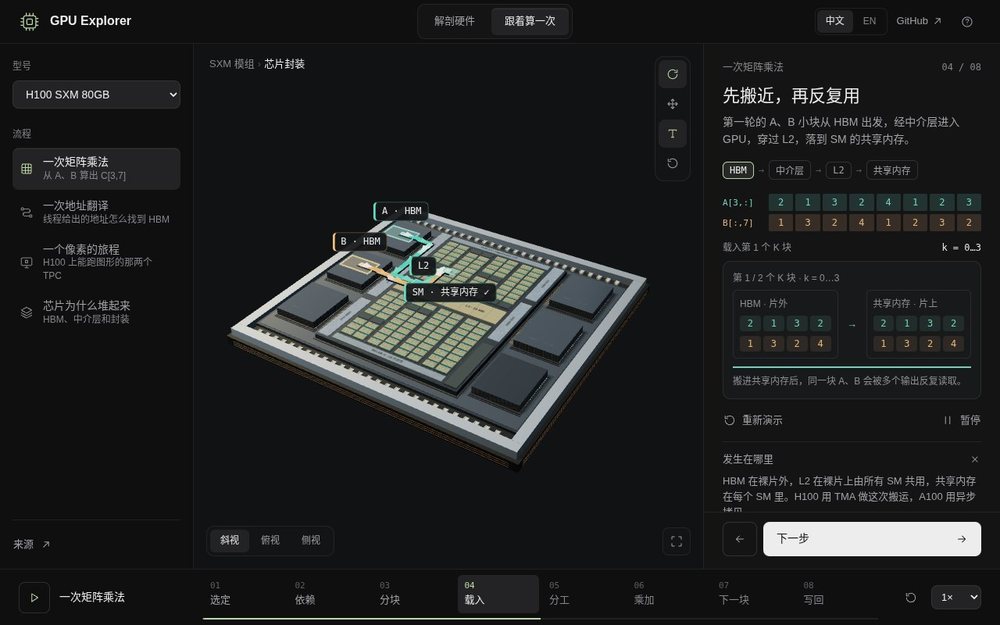 | 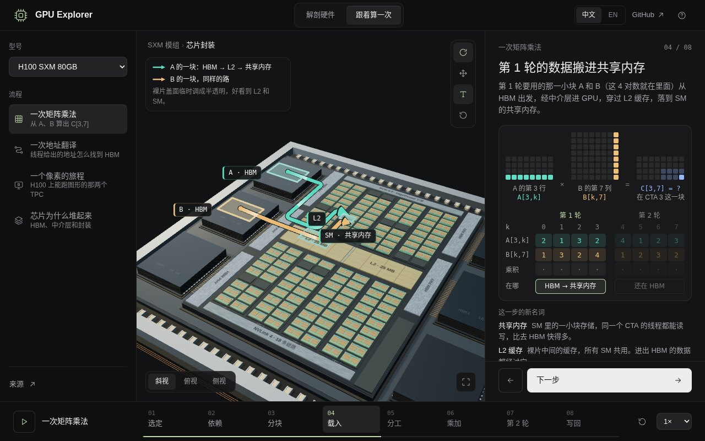 |
| Matrix multiply 6 · multiply | 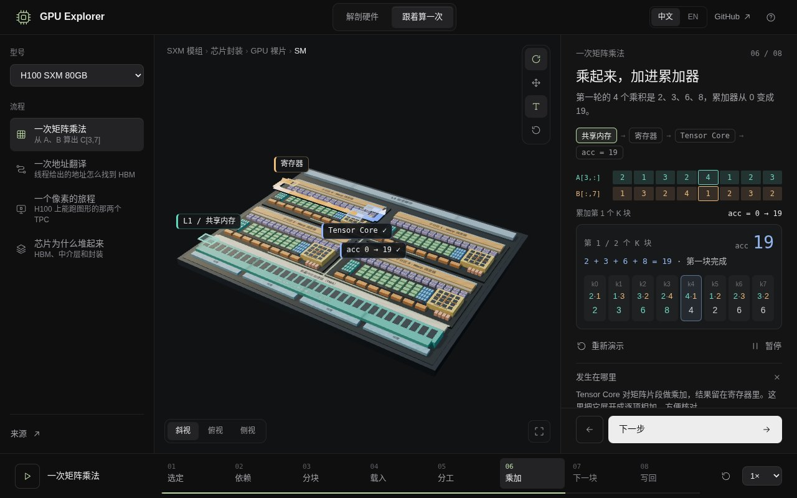 | 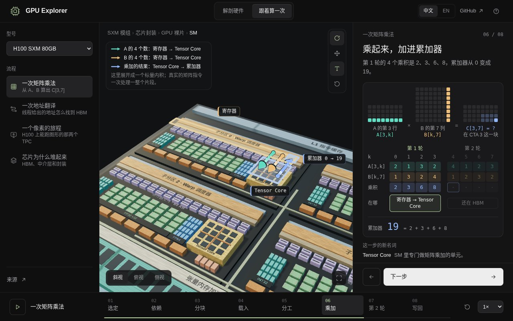 |
| Address translation 1 · issue | 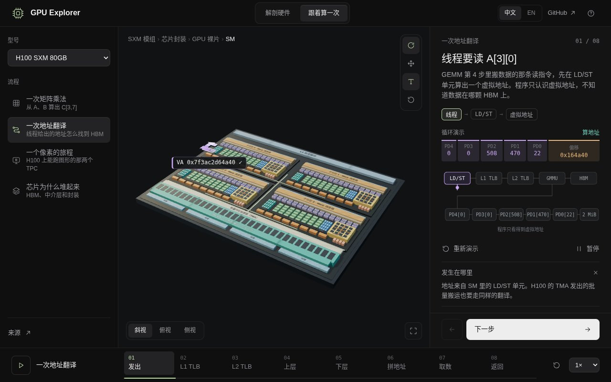 | 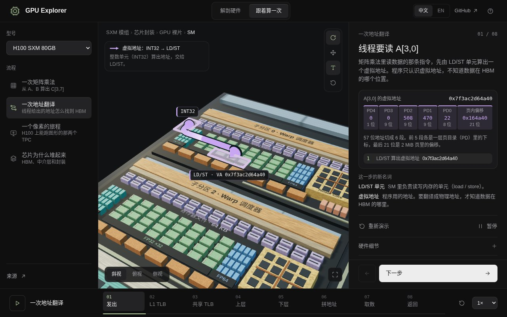 |
| Address translation 4 · page walk | 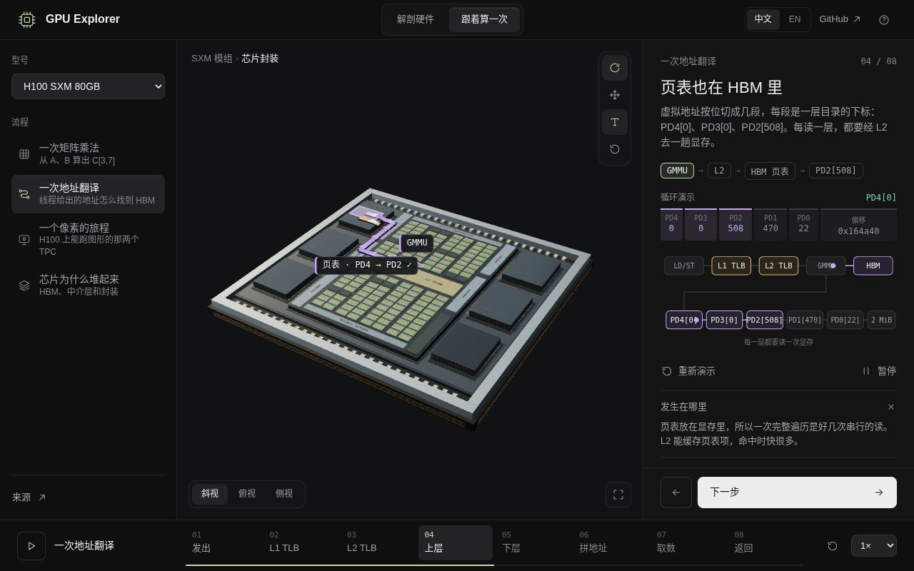 | 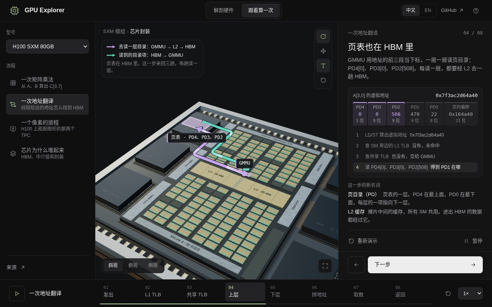 |
| One pixel 4 · raster | 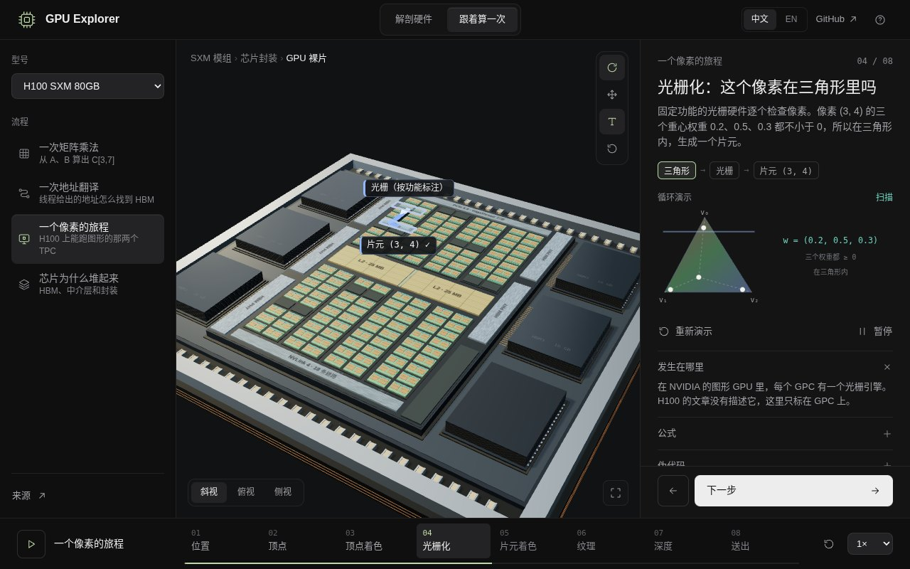 | 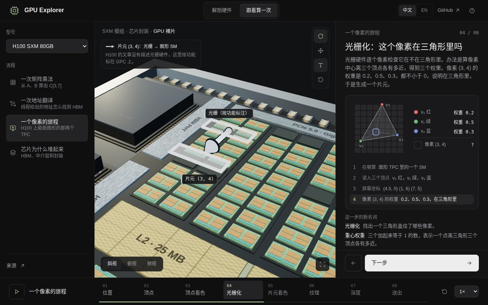 |
| One pixel 7 · depth and write | 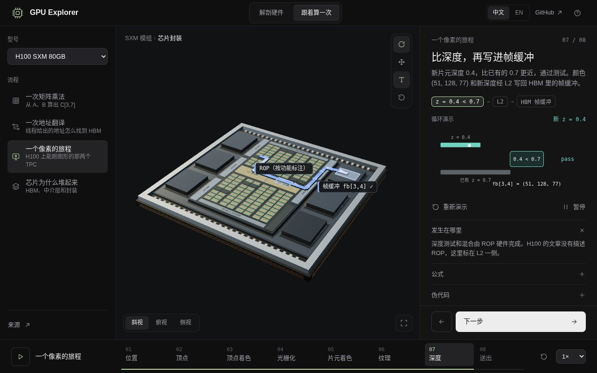 | 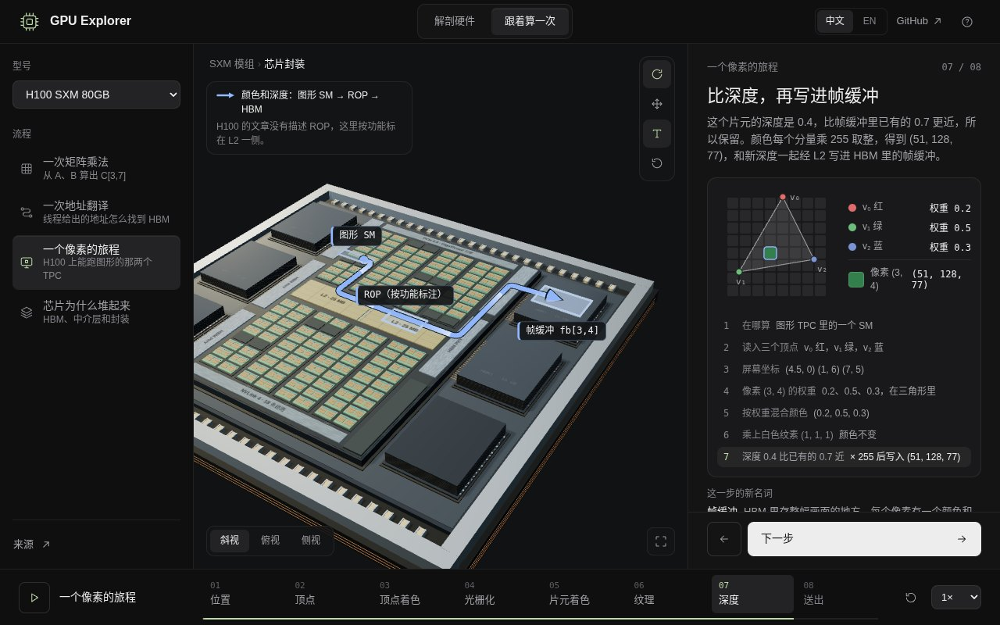 |
| Stacking 4 · 1024-bit interface | 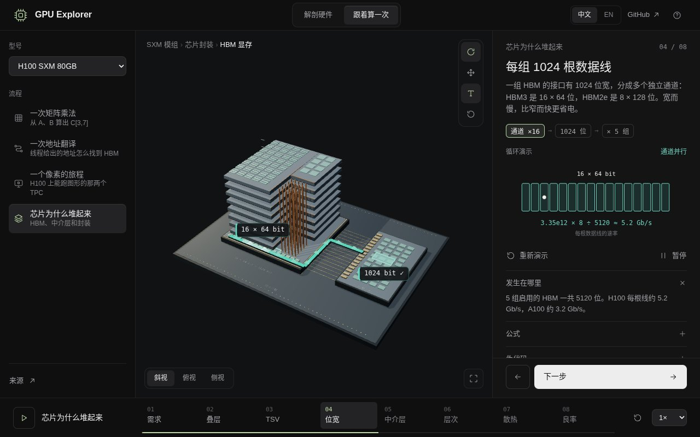 | 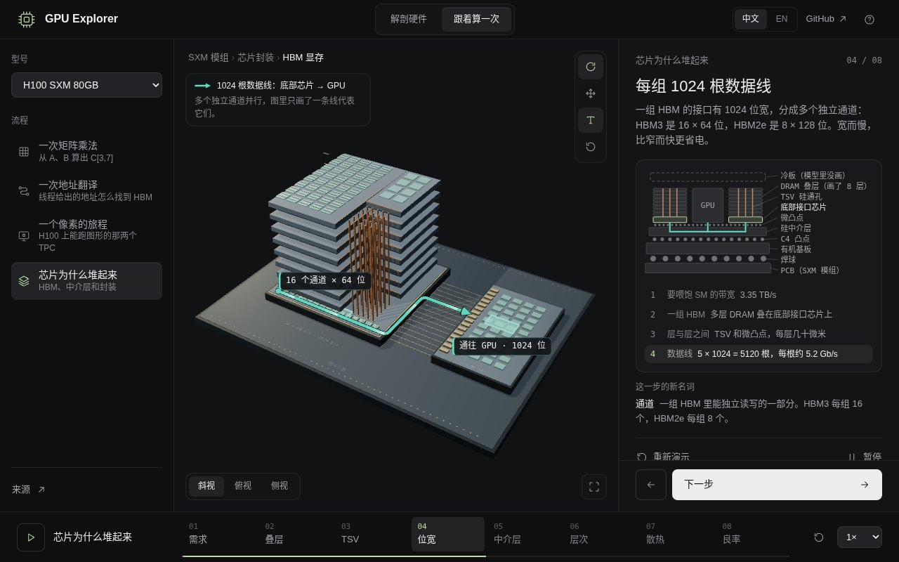 |
| Stacking 6 · silicon to PCB | 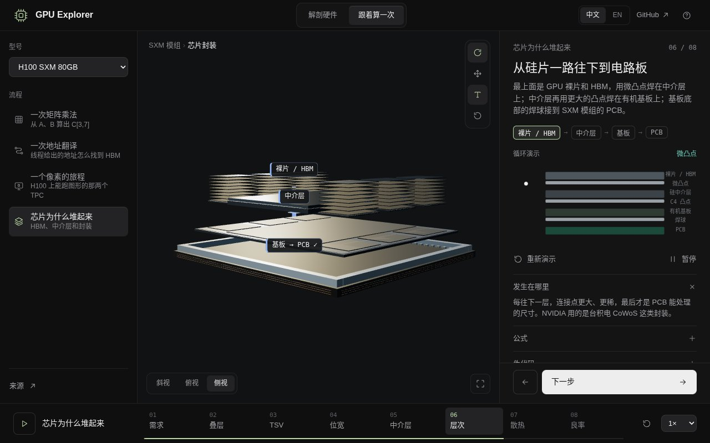 | 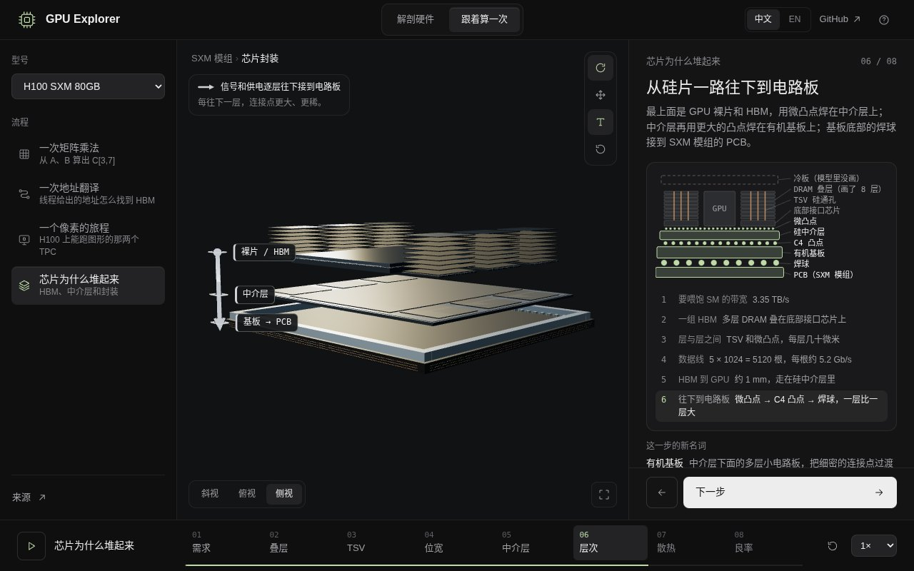 |

English: [matrix multiply 7](walkthroughs-2026-11-10/after-gemm-7-en.jpg), [address translation 4](walkthroughs-2026-11-10/after-pagetable-4-en.jpg).

## Tests

- `./run_tests.sh`: 181 checks plus the HTTP contract. New or changed: the matrix figure keeps the eight pairs and marks the active round, location under the numbers, notes on step 1 only; the running record; glossary and one-name-per-thing; walkthrough titles; lane gaps and arrow proportions for every step on both models.
- `./run_e2e.sh` (Chromium, SwiftShader): 25 whole-page tests. New: the on-model key and the step's terms on every step, the figure directly under the text, the current line of the figure visible without scrolling at 1280 × 800, no label under the key box, the matrix figure's outlined round and filled products through steps 3–8, and labels on in walkthroughs / off in Anatomy, remembered per tab.

## Not done

- The step copy in `state.js` was revised in the unfinished session; this session reviewed it for repetition and terms but did not rewrite it again.
- Colours are fixed per meaning (teal data read, orange the second input, blue a result, purple an address, grey work or instructions, red-orange heat) and listed in the key on each step; there is no separate always-on legend.
