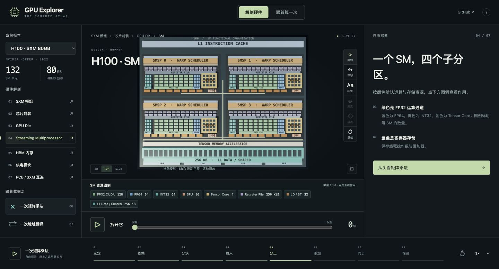
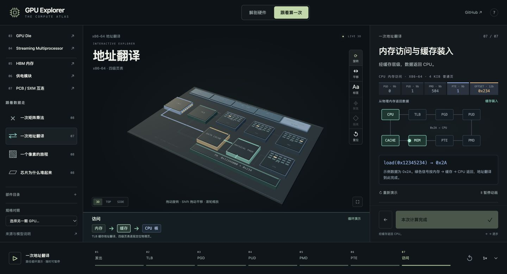
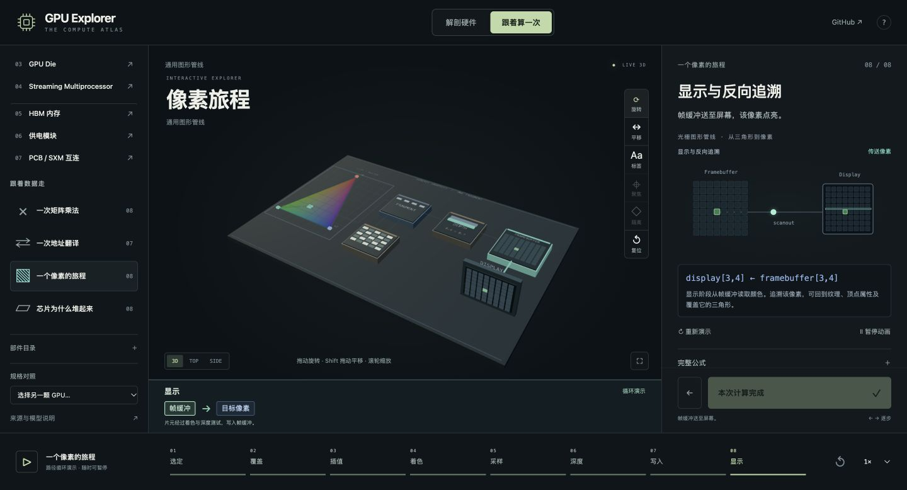
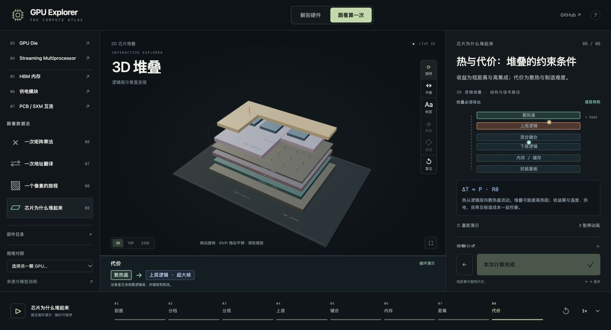
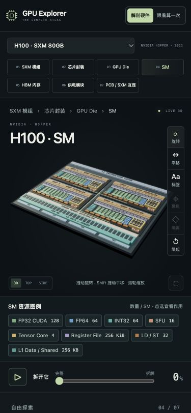

# 旅程动画、平移与 SM 图例 · 2026-11-02

[在线页面](https://yingxu-work.github.io/gpu-explorer/?rev=20261102r) · [浏览器检查记录](browser-checks.json) · [SM 资源资料](../SM_EXECUTION_UNITS.md)

## 本轮变化

- 地址翻译 7 步、像素旅程 8 步、芯片堆叠 8 步：独立 3D 场景与右侧图、数学、解释联动，动画按独立相位持续运行。
- 新增旋转 / 平移工具。平移工具使用主键拖动；Shift 拖动与右键拖动也可平移。拖动过程停止拾取，平移后调整窗口尺寸保留取景。
- 悬浮标签默认隐藏，开启后也不会拦截模型拖动。SM 的资源名称、颜色和数量放在画布下方；选中部件的详情放在右侧。
- 数据脉冲缩短至最多 0.12 单位，宽度为总线的 65%，改用对应线路的浅色；每条长路径最多两段。
- SM 单独命名和拾取 FP32、FP64、INT32、SFU、Tensor Core、寄存器、LD/ST 与缓存资源。绿色表示 FP32 CUDA 通道，紫色表示寄存器。
- 扫描并清理正文、部件卡片、展开面板、伪代码注释、问答反馈和表面刻字中的防御性文案。正文只保留部件作用、工作过程和操作方法，来源入口保留规格与资料链接。

## 真实页面截图

### SM 颜色与资源

### 地址翻译

### 像素旅程

### 芯片堆叠

### 手机视图

## 验证

`./run_tests.sh`：212 项检查全部通过，HTTP 集成通过。包含资源数量与实际射线选取、23 步右侧图的移动/暂停、19 项 3D 场景几何与阶段测试，以及原有矩阵数学、状态、相机和组件检查。

Chrome / WebGL 本轮 39 组操作通过：23 个新增步骤逐一检查阶段、两次相位与 SVG 坐标变化；三个旅程分别暂停、平移、恢复；平移工具主键拖动、Shift 拖动、尺寸变化保留取景；手机入口与颜色图例；以及 SM、TMA、Shared、DRAM、底部接口的实际文案检查。测试覆盖 p / q / r 三个迭代版本，最终发布为 r。控制台未记录错误或警告。

堆叠分层在数值进度完成后仍循环改变层间距。两个时钟相互独立，暂停时模型位置与右侧图同时冻结。
